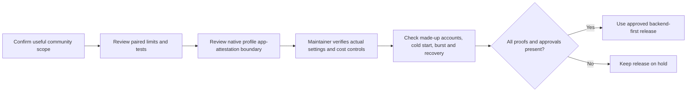

# A simple, low-cost community website

**Purpose:** keep the community experience useful while limiting services, recurring work, and spending exposure.

**Approver:** Dave Liu for the current simplification request. Any release still uses the named platform/security reviewers. Regular club expenditure needs the club's finance approval; willingness to supply a personal card is not an unlimited club budget.

**Checked:** 2026-10-11. Trial billing and warning-budget settings below were checked directly. Profile Functions and the member/payment workflows are still **NOT AVAILABLE YET**.

## What we are prioritizing

- Clear information about regular runs, meeting places, joining, and contacts.
- A useful events/calendar experience on phones as well as computers.
- Public information without requiring an account.
- Optional secure accounts for features that actually need them.
- Existing club-approved external links when an outside service already does the job.

Prefer static pages and published public content: visitors can receive files from the host without running a server operation for each page view. Where events need database content, use bounded reads and avoid unnecessary polling. This is the implementation direction, not a claim that the Events service has been repaired. Production Events/Calendar still have the recorded unavailable state pending their own reviewed release.

The first profile backend remains exactly two server operations: create a missing account profile and recover it safely. Keep checkout, refunds, inventory, automatic email, photo uploads, directory search, and Strava synchronization out of that particular deployment. Their existing code and safety requirements remain preserved.

Dave clarified the core scope on 2026-10-11: club membership, events, member signup/cancellation, officer event management, and payments/refunds/bib transfers for **MPRC-organized races**. These money workflows are priority follow-on releases, not optional features to abandon. Keep Firebase for club records and use hosted card checkout. Custom outbound email can wait; account status and officer recovery must not depend on it. This does not waive Authentication verification/recovery requirements. Do not add automatic membership subscriptions, choose club refund/transfer policies, remove an existing service, or claim any of these workflows are live through this guide.

## Trial billing and cost warnings — VERIFIED for engineering staging only

[COST-002 #693](https://github.com/Run-MPRC/Run-MPRC.github.io/issues/693) linked only `run-mprc-staging` to the existing club Free Trial billing account. The club Console showed $300 unused, expiring **January 10, 2027**. Linking the project enables Firebase's Blaze plan during the trial; it does not upgrade the billing account to paid. No paid upgrade was performed. Without an explicit paid-account upgrade, Firebase says linked projects downgrade to Spark when the trial ends; plan ongoing hosting before that date rather than treating credits as permanent funding.

The warning budget is named **MPRC staging gross usage alerts**. It covers only staging, all services, and each calendar month. Its amount is **$10 USD**, with actual-usage alerts at **$5, $9, and $10**. Credits are excluded from the calculation so trial credits cannot hide underlying usage. Default billing-account notification recipients remain enabled; no new recipient, access grant, Pub/Sub automation, or shutdown rule was added. Configuration was read back; email delivery was not tested.

This is an **alerts-only budget**, not a bill ceiling or approval to spend club money. The only API enabled by this step was the Cloud Billing Budget API. Functions, Cloud Build, and Artifact Registry APIs remain disabled. Production billing remains disabled/unlinked. No Function, website, DNS, Stripe configuration, member record, or payment was changed. See the [staging billing map](./SYSTEM_MAPS.md#engineering-staging-billing--checked-2026-10-11).

### Check the trial and warnings without a terminal

**Purpose:** verify the engineering trial and detect underlying costs before approving ongoing hosting.

**Approver:** Dave Liu for this trial setup; treasurer/club finance approver for regular club expenditure. Platform/security approval is still required for a backend release.

**Prerequisites:** the club Google account, the private billing-owner record, and the platform maintainer's dated #693 provider readback. Do not paste account identifiers or payment details into AI, GitHub, email, or screenshots.

1. Ask the platform maintainer to show the club account's Google Cloud trial status privately.
2. Confirm the account says **Free Trial**, not a paid account.
3. Confirm the remaining credit and expiry date; the October 11 checkpoint was $300 and January 10, 2027.
4. Ask the maintainer to show that only the intended staging project was linked in #693.
5. Open the budget named **MPRC staging gross usage alerts** in the private billing Console.
6. Confirm staging-only scope, a monthly $10 amount, and exclusion of credits.
7. Confirm actual-usage alerts at 50%, 90%, and 100%, with default billing recipients enabled.
8. Compare gross usage with expected engineering activity before approving any ongoing paid hosting.
9. Ask for separate deployment and made-up-account evidence before treating a member feature as usable.

**Expected result:** the officer can distinguish trial credit, underlying usage, configured warnings, and a usable backend. No officer needs to edit source, run commands, or handle a secret.

**Stop conditions:** wrong account/project, a paid upgrade, missing or changed budget settings, unexplained usage, an approaching trial expiry without a hosting decision, or a claim that the budget stops spending. Do not click **Upgrade**, switch off billing, or disable services as an improvised response.

**Success proof:** dated private Console review plus separate API readback of the billing link and every budget setting. An alert configuration is not proof an email was received, a cap was enforced, or a Function was deployed.

**Undo:** pause new staging release work and ask the platform maintainer to check dependent resources before proposing a reviewed unlink or API change. Do not shut down a payment backend to save costs; callbacks and refunds need their own continuity plan.

**Escalation:** platform maintainer for account/configuration or service failures; treasurer/finance approver for spending; cardholder for a paid-account decision. Provider setup and deployment still require a specialist.

## Cost controls in source — NOT AVAILABLE YET in hosted Functions

[Issue #683](https://github.com/Run-MPRC/Run-MPRC.github.io/issues/683) sets the same resource options on both profile operations:

| Setting | Meaning |
| --- | --- |
| Minimum instances: 0 | No server instance is reserved to sit idle. A first request after inactivity can take longer. |
| Maximum instances: 2 per operation | Limit normal automatic scaling. This is not two users or two requests per month. |
| Memory: 256 MB | Use the existing small memory size explicitly. |
| Execution timeout: 30 seconds | Stop unusually long execution; a timed-out request can have an uncertain result. |

These are resource settings, **not a maximum monthly bill**. Google can briefly exceed the instance limit during traffic surges. A busy HTTP operation can queue requests and return a temporary busy response. Persistent storage, deployment files, database use, and other services can still cost money. The profile remains create-once so retrying an uncertain result does not overwrite existing information or grant membership.

The #683 source change configured no budget, spending cap, artifact-cleanup policy, billing account, Function, or new host. Its 2026-09-27 billing-disabled/zero-accessible-accounts checkpoint is historical and superseded only for staging billing and the warning budget by the October 11 #693 readback above. Hosted Function limits remain unverified. Card details belong only in Google's secure payment form.

[Issue #691](https://github.com/Run-MPRC/Run-MPRC.github.io/issues/691) prepares Node 22, the program that runs the server code. Google schedules the old Node 20 runtime to be taken out of service on October 30, 2026. The update keeps the same two operations and resource limits. It adds automated compatibility and made-up profile checks, but does not deploy anything or fix every dependency warning. Hosted Node 22 behavior is **NOT AVAILABLE YET**.

## Profile recovery app attestation — SOURCE ONLY; NOT AVAILABLE YET

**Purpose:** make sure profile recovery accepts only a verified request from the club app, even if an environment setting is missing. App Check is Firebase's app-attestation check; it does not establish membership or officer permission.

**Approver:** the named platform/security release approver. **Prerequisites:** reviewed [#695](https://github.com/Run-MPRC/Run-MPRC.github.io/issues/695) source, existing release dependencies, exact deployed-source proof, and isolated staging with made-up identities only. The source change does not deploy a Function or change billing.

1. Ask the maintainer for the exact source and passing request-boundary tests.
2. Confirm only profile recovery gained native enforcement; signup, role policy and other services were not widened.
3. Observe the maintainer's private staging check that a request without app attestation cannot read or create a profile.
4. Observe the corresponding invalid-attestation rejection.
5. Observe a made-up signed-in member with valid app attestation recover one pending profile.
6. Confirm anonymous/invalid-auth and injected-field requests fail, and retries preserve profiles and roles.
7. Record source, tests, merge, staging/provider and production states separately.

**Expected result / success proof:** exact reviewed source plus staged denial and valid recovery evidence. Source tests use synthetic token verifiers, not real Google token verification; resource-setting readback alone is not request proof. Officers do not run commands, handle tokens, enter real member data or edit cloud settings.

**Stop conditions:** an unverified request succeeds, valid app attestation stops requiring sign-in, a flag can disable the boundary, or hosted evidence is missing. A local request without attestation is expected to fail; do not fall back to production to get a successful test.

**Undo:** hold an unverified release. Ask the maintainer for a compatible protected roll-forward or rollback that preserves native enforcement; do not disable App Check or edit a member record.

**Escalation:** platform/security maintainer. A specialist remains necessary for provider setup, tests and deployment.

## Review before a low-cost release

**Prerequisites:** issues #683 and #691 and their reviewed pull requests; the exact release source and test results; a named release approver; a private billing/payment-owner decision; and a platform maintainer. The existing release dependencies still apply. Never put payment details, passwords, or member records in an issue.

Text alternative: confirm the small scope, review source and native profile app attestation, verify provider controls, test quality with made-up accounts, and release only when every proof and approval is present.

1. Confirm the public pages to keep and the two profile operations to deploy.
2. Confirm the release adds no payment, email, photo, or synchronization service.
3. Ask the maintainer for the exact merged source and all six passing checks, including “Node 22 backend compatibility.”
4. Ask for separate provider evidence of Node 22 and all four resource settings on each Function. Google may leave out a zero minimum-instance value; the maintainer must show that this was decoded using Google's documented format. Other missing or malformed settings are not proof of safe defaults.
5. Ask for the agreed alert recipients and budget amount. Alerts do not stop charges.
6. Ask whether a service spending cap is available and configured. It does not guarantee a whole-project bill ceiling or instant shutdown.
7. Ask for deployment-file cleanup and storage-retention evidence. Do not delete database backups as a cost shortcut.
8. Observe the maintainer's made-up account checks: first sign-in after inactivity, a small concurrent burst, profile recovery, retry, and the readable busy/unavailable state. Never create or edit a real member for this test.
9. Confirm public run/join/contact information stays usable when the account service is unavailable. Events data may still depend on the database; do not promise an offline calendar unless separately tested.
10. Record the date, named reviewers, source revision, fixed pass/fail results, and separate source/merge/website/Firebase/provider states.

**Expected result:** officers can identify the small launch scope, understand the limits, and verify the release without a terminal or payment details.

**Stop conditions:** unknown billing owner, unapproved service, claims of guaranteed zero cost, missing provider settings, poor cold-start/burst behavior, real-data testing, an unexpected allow, or missing deployment/rollback evidence. Stop if runtime maintenance or the existing #113/#133/#136 dependencies remain unresolved for the requested release.

**Success proof:** a reviewed source/CI record plus separate provider readback and synthetic quality evidence. Source tests alone cannot prove lower bills or a good hosted experience.

**Undo:** before release, hold the change. After release, ask the platform maintainer to use the reviewed compatible rollback or safe roll-forward on a supported runtime. Do not assume the old Node 20 version can be redeployed after its retirement date. Reverting the limits can raise spending exposure and requires review. Do not edit a profile, widen permissions, switch off billing, or delete resources as an improvised fix.

**Escalation:** platform/security owner for reliability or access; treasurer/finance approver for recurring club costs; cardholder for payment authority. A specialist is still needed for provider setup, release, and rollback. This guide does not claim independent officer deployment is available.

## References

- [Google's server runtime support dates](https://docs.cloud.google.com/functions/docs/runtime-support)
- [Firebase resource settings and saturation behavior](https://firebase.google.com/docs/functions/1st-gen/manage-functions-1st)
- [Google maximum-instance caveat](https://docs.cloud.google.com/functions/docs/reference/rest/v1/projects.locations.functions)
- [Google's zero-value response format](https://protobuf.dev/programming-guides/json/#presence-and-default-values)
- [Spending-cap coverage and overages](https://docs.cloud.google.com/billing/docs/how-to/budgets-spend-caps)
- [Firebase Hosting usage](https://firebase.google.com/docs/hosting/usage-quotas-pricing)
- [Firebase free-trial billing and expiry](https://firebase.google.com/support/faq/#pricing)
- [Budget scope and notification settings](https://docs.cloud.google.com/billing/docs/how-to/budgets)
- [Firebase native callable App Check enforcement](https://firebase.google.com/docs/app-check/cloud-functions)
