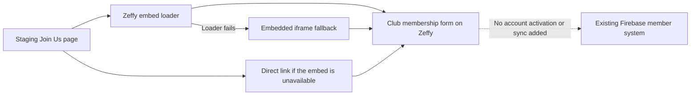

# Review the Zeffy membership form

**Status:** [issue #750](https://github.com/Run-MPRC/Run-MPRC.github.io/issues/750), staging display verified October 18, 2026. [Open the view-only preview](https://run-mprc-staging--zeffy-750-nqx3741y.web.app/joinus#membership-signup). Production is **NOT AVAILABLE YET** for this change.

**Purpose:** review the embedded membership form on the Join Us page without creating a membership or payment.

**Approver:** Dave for this staging demonstration. The membership lead, treasurer and platform owner must approve a later production release.

**Prerequisites:** the specialist supplies the exact staging preview link and source revision. Stay signed out. The displayed Zeffy form is the club's real form, not a payment sandbox. Do not enter information, accept a waiver, submit or pay.

In words: the Join Us page displays the club's form from Zeffy and retains a separate direct link; a failed loader uses an iframe, and this change adds no Firebase membership synchronization.

## Review without a terminal

1. Open the specialist's staging link while signed out.
2. Find **Become an MPRC Member** on Join Us.
3. Confirm the notice identifies a staging preview of the real Zeffy form.
4. Confirm the club's membership options or opening message appear inside the page.
5. Open **Open the membership form in a new tab**.
6. Confirm it points to the club's membership on `www.zeffy.com`.
7. Close the new tab without entering information.
8. Return to Home and then Join Us.
9. Confirm only one visible membership form appears.
10. Repeat at phone and computer widths.
11. Leave the separate **Sign Waiver Form** unchanged and unused.

**Expected result:** the form is readable within Join Us. A direct link remains usable if the embed fails. There is no duplicate Google membership signup link. Prices and renewal terms are supplied by Zeffy; this change does not settle the conflicting provider description and options noted October 18.

**Stop conditions:** wrong club/form, missing real-form notice, clipped controls, duplicate forms, missing direct link, unexpected account activation, or any request to test a payment or submit real details.

**Success proof:** exact source revision, staging URL and deployment ID, dated phone/computer screenshots, one-form navigation check, loader/fallback tests and served artifact hashes. Viewing a form proves display only. It does not prove payment, membership activation, provider configuration or production readiness.

**Undo:** ask the platform maintainer to expire the task's preview channel. For a later published change, use a reviewed revert and the normal protected release path. Do not edit Zeffy records, delete members or refund a payment to undo a website preview.

**Escalation:** platform owner for display or deployment; membership lead and treasurer for provider options/prices; privacy owner for collected data or policy. A specialist is still required for deployment.

## Deployment evidence

- Source: deployed implementation `c750d7bac5905eb25f20b0e5726006e719b06c0b`; not merged. Later documentation-only evidence commits do not change its executable source.
- Tests: 28 frontend suites / 1,531 tests pass under Node 20. The new files have no lint findings. The exact lint baseline retains the same 113 legacy errors and six legacy warnings; only two old Join Us findings move with the removed Google-link lines.
- Hosting checks: all 16 pass. A test first reproduced the rejected Zeffy slug, then passed with the exact form-literal exception. All real production identifiers, endpoints, changed hosts and changed form suffixes still reject.
- Staging website: project `run-mprc-staging`, preview channel `zeffy-750`, version `67290871d20f4d57`. All 61 served file hashes match the local artifact. Preview expires October 25, 2026 at 5:50 PM Pacific time.
- Actual signed-out screens: 390×844 phone and 1280×720 desktop; form choices, real-form notice, direct-link target and zero page horizontal overflow verified. Home → Join Us reinitializes one visible form and one loader. A spacing correction avoids the site's outer-section margin. Dated screenshots are retained with this chat; no member or payment information was entered. Fallback behavior is covered by the local tests; no provider failure or checkout was induced.
- Existing shared staging: version `6619f96ac1a39406` unchanged. Preview deployment explicitly disabled Auth-domain synchronization and did not enable the community or test-dues feature flags. No CI workflow was manually dispatched.
- `runmprc.com`: unchanged; no production release authorized.
- Firebase Functions, Rules, Auth, IAM and data: unchanged.
- Zeffy account/form configuration: unchanged; public form display only.
- Payments and membership submissions: not performed.

The first compiled artifact was refused because the approved Zeffy slug overlapped the production-project text scan. The narrow exception above was tested before retry. A later successful CLI publication omitted its version field; native channel readback and all-file verification qualified that release without another deployment. The final spacing revision was then published and all 61 files verified again. No deployment guard was skipped.
